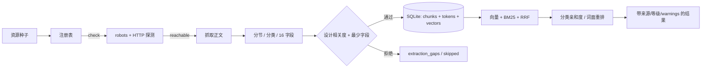

# DSH Art UI/UX Pro Max

一个 **TypeScript 原生**的 UI/UX 设计知识引擎与 DSH 插件。

它不做三件事：不收藏截图、不把网页可访问当成学习完成、不把审美判断当成可用性结论。
它做一件事：把公开资料变成**可检索、可追溯、可量化评测**的设计知识，并能反向支撑真实设计任务。

内置设计智能库：**88 种风格 · 192 套调色板 · 74 组字体搭配 · 195 条 UX/Web/React 规范 · 192 份产品配方**（静态、离线、可溯源）。

> 运行时代码已全部迁移到 TypeScript（Node ≥ 22.6，本机验证 24.19）；Python 实现与
> vendored Python 引擎已移除，迁移细节见 [docs/MIGRATION-TS.md](docs/MIGRATION-TS.md)。
> `docs/` 下的旧交付/评测报告是 Python 时代的历史材料，已加注说明。

## 架构

```
src/
  domain/          设计领域：12 分类、注册表、提取、案例证据、七步工作流、组件学习、设计智能库
  infra/           HTML 分节、受控 HTTP、SQLite 存储、BLAKE2b 特征哈希、BM25/RRF
  application/     服务层 + 16 个原生工具
  plugin/          DSH 入口与设置/统计路由
  client/          设置卡（编译为 dist/client/index.js）
  mcp/             可选 MCP stdio 兼容层
  cli.ts           命令行
resources/seed.json  62 条资源种子（15 字段，只读）
resources/design-library.json  88 风格/192 调色板/74 字体/195 规范/192 配方
resources/design-aliases.json  413 条中文领域别名
plugins/art-uiux/    DSH 插件清单、空 patch、图标、locale
tests/              58 个 node:test 测试（单元 + 集成）
```

### 数据流



## 快速开始

```bash
npm install
# Android / 共享存储不支持软链接时： npm install --no-bin-links
npm run build
npm test

# 资源探测（写 access_status，不代表已学习）
node dist/cli.js check --limit 5

# 正式抓取入库（写 learn_status 与真实片段数）
node dist/cli.js ingest --only m3-material,nng --max-units 8

# 检索（中文会自动补英文设计术语）
node dist/cli.js search "深色模式下的对比度怎么控制" --top 5

# 七步设计工作流（产出 docs/tasks/*.md/html/ds.json）
node dist/cli.js design --task "做一个金融行情终端首页"

# 案例证据分析（产出 docs/cases/*.md/json）
node dist/cli.js case --resource linear

# 组件库学习（GitHub 元数据 + README + 文件树，不下载源码包）
node dist/cli.js components --keys shadcn-ui,ant-design,vico

# 设计智能库：完整配方 / 规范审查 / 定点检索
node dist/cli.js recommend "财务 数据看板 深色 高密度"
node dist/cli.js review "移动端登录页，提交后没有任何反馈" --platform mobile
node dist/cli.js library "毛玻璃 深色" --domain style

# 真实统计
node dist/cli.js stats
```

也可以 `npm link` 后使用 `art-uiux` 命令，或 `npm run cli -- <command>`。

## 安装到 DSH

```bash
npm install
npm run build
dsh plugin --profile web add link:/path/to/dsh-art-uiux-pro-max
```

再把 `"@local/art-uiux"` 加入该 profile 的 `dsh.profile.bundles`，重启 DSH。
插件入口直接注册 16 个原生工具，`plugins/art-uiux/cordis.patch.yml` 是空 patch，
不启动任何 Python 或 MCP 子进程。

设置卡（设置 → 插件 → Art UI/UX）可改数据目录、网络开关、私网开关、单次学习上限与重排策略。

## 16 个原生工具

| 工具 | 作用 |
| --- | --- |
| `art_taxonomy` | 12 个主分类 × 12 项元数据、16 个提取字段 |
| `art_registry_list` | 种子 + 运行期状态合并视图 |
| `art_registry_check` | robots 前置的真实访问探测 |
| `art_learn` | 抓取、分节、分类、16 字段模板、正式入库 |
| `art_case_analyze` | fact / inference / opinion 三分证据与数值冲突登记 |
| `art_search` | 向量 + BM25 + RRF + 亲和度重排，带来源/等级/warnings |
| `art_route_task` | 任务类型与相关分类 |
| `art_directions` | 有实质区别的视觉方向（拒绝默认陈词滥调） |
| `art_design_system` | Tokens + CSS + WCAG 对比度实算 |
| `art_audit` | 10 项设计审计，不能测的标 `unmeasured` |
| `art_responsive` | 多断点布局矩阵（静态推断） |
| `art_backgrounds` | 三种背景方案 + 文字对比度实算 |
| `art_recommend` | 产品/行业 → 风格、16 色令牌、字体、落地页、UX 规范、反模式与旋钮 |
| `art_review` | 按 195 条 UX/Web/React 规范审查，按严重度排序，附正误代码 |
| `art_library_search` | 按域检索 88 风格 / 192 调色板 / 74 字体 / 195 规范 / 192 配方 |
| `art_stats` | 资源/片段/等级/索引完整性与设计库计数 |

## 设计智能库

`resources/design-library.json` 是 [dsh-ui-ux-pro-max](https://github.com/ChenYiming-aaa/dsh-ui-ux-pro-max)
v1.4.1（MIT）的静态子集快照，上游为 `nextlevelbuilder/ui-ux-pro-max-skill@56ea9cf`。
包含 9 个域 + 192 条推理规则；**不包含**字体二进制、图标/GSAP/技术栈表。
完整来源与许可见 [THIRD_PARTY_NOTICES.md](THIRD_PARTY_NOTICES.md)；学习过程与差异记录见 [docs/LEARNING-UIUX-PRO.md](docs/LEARNING-UIUX-PRO.md)。

检索与推荐是本项目自己的 TypeScript 实现：
- BM25（k1=1.5 / b=0.75）+ 413 条中文领域别名，单字查询走 4 条短词典；
- `art_recommend` 按产品类别 → 推理规则 → 风格/调色板/字体/落地页/UX 五步组装；
- 16 个颜色令牌直接映射为 `--color-*`，但**不替代** `art_design_system` 的 WCAG 实算；
- 9 条 `deprecated` 风格默认排除，查询命中 `legacy` / `deprecated` 时才保留；
- 推荐与审查输出带来源版本与 commit，不把上游结论当作本项目实测结论。

## 知识模型

- **唯一主分类**：`chunk.topic` 只能是 12 个 key 之一；辅助标签写 `metadata.secondary_categories`。
- **等级必须挣得**：L1 仅解析/归类；L2 需要原则 + 显式约束语境；L3/L4 只能来自交叉验证或真实任务。
- **三态分离**：`access_status`（能否访问）、`learn_status`（学到哪一步）、`learned_chunks`（真正入库条数）不可互替。
- **去重**：同项目同 `content_hash` 直接跳过并计入 duplicates；更新同一 `chunk_id` 会重建倒排与向量。
- **不可入库的内容**：营销文案、能力边界声明、纯主观 opinion、设计相关度不足的段落。

## 检索与评测

默认检索链路是：512 维 BLAKE2b 特征哈希向量 + BM25 + RRF 融合，再用分类亲和度与词面重叠重排。
这是确定性、离线、可复现的方案，**不是神经语义模型**；中文查询会经 63 条设计术语表做确定性扩展。

交叉编码器（`rerank=ce`）没有打进 TS 运行时：请求时会明确降级为规则重排并写入 warning，
不会返回伪造的 CE 分数。

本仓库不包含生产知识库（`data/` 被忽略），因此不宣称任何检索指标。先 `check` + `ingest`，
再运行：

```bash
node dist/cli.js eval
```

qrels 在 `eval/qrels.json`（18 条查询），逐条结果写入 `eval/runs.json`，报告写入 `docs/EVAL-REPORT.md`。
旧版 Python 报告中的 143 片段指标无法在本仓库复现，已标注为历史数据。

## 安全边界

- **robots.txt 前置**：禁止路径记 `blocked`，不绕过；401/403/404 有区分处理。
- **SSRF 防护**：默认拒绝 loopback、RFC1918、link-local、IPv6 ULA 与解析到私网的域名；
  重定向每一跳重新校验；设置里显式开启才允许私网。
- **抓取限额**：256 KB、20 s 超时、最多 6 跳重定向、拒绝非文本 content-type。
- **网络开关**：`allowNetwork=false` 时抓取直接失败，不会静默返回缓存或空结果。
- **不执行任何页面代码**；MCP 仅 stdio，不监听端口。

## 测试

```bash
npm test        # 58 passed（单元 + 集成）
npm run typecheck
```

覆盖：分类校验、注册表状态隔离、分节/分类/等级、案例证据分级、WCAG 对比度与审计状态、
组件分类与知识等级、IR 指标、双语扩展、SQLite 入库/去重/过滤/检索、robots/重定向/SSRF、
设置校验、服务层端到端、MCP 握手、插件注册。

## 能力边界（如实）

- 无浏览器级渲染：不产出真实截图，不判断视觉美观；布局矩阵是静态推断。
- 无用户研究数据：不生成任何用户测试、转化率、可用性结论。
- 组件字段覆盖浅：只读元数据/README/文件树或单文件源码，不构建、不运行。
- 语料规模由你实际入库决定；种子只有 62 条资源，且大多尚未学习。
- 设计库是上游 MIT 数据的静态快照；调色板/规范未逐条重测，不能替代 WCAG 实算与真实渲染。

## 许可

MIT，见 [LICENSE](LICENSE)。设计智能库数据来自 [dsh-ui-ux-pro-max](https://github.com/ChenYiming-aaa/dsh-ui-ux-pro-max)（MIT）及其上游，
来源、快照 commit 与包含范围见 [THIRD_PARTY_NOTICES.md](THIRD_PARTY_NOTICES.md)。
学习过程中引用的第三方资料仍归原作者所有；知识库只保存归纳结论与来源链接，不复制原文全文或素材本体。
